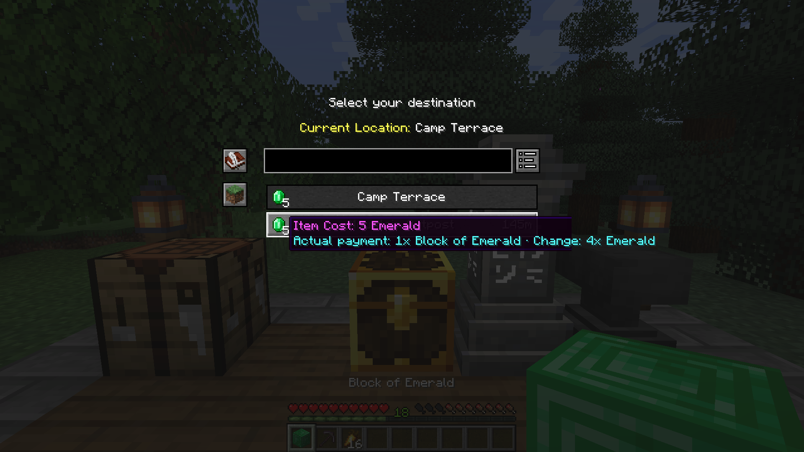
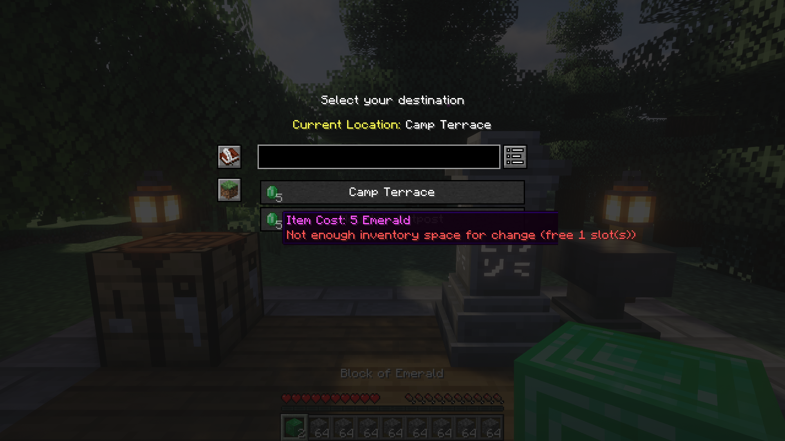
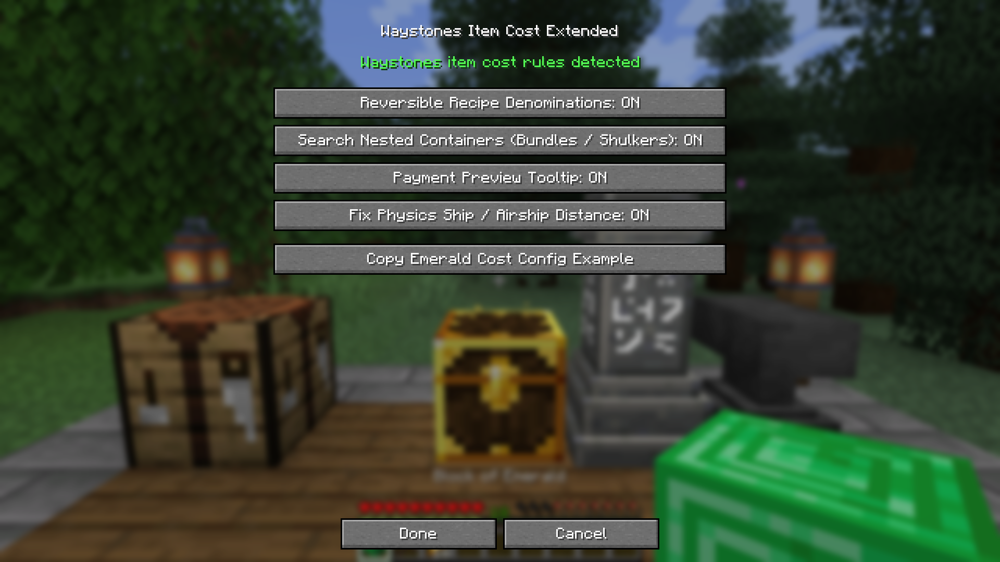

# Waystones Item Cost Extended

<p align="center"></p>

<!-- PROJECT_PAGE_START -->

**Waystones Item Cost Extended** makes item-based [Waystones](https://modrinth.com/mod/waystones) fees practical for survival servers and modpacks: pay with blocks or nuggets and get exact change back, pull payment items straight out of Bundles and Shulker Boxes, pay with [Lightman's Currency](https://modrinth.com/mod/lightmans-currency) wallets, and teleport cleanly to Waystones mounted on **Sable** or **Valkyrien Skies 2** airships and ships — even when parked in unloaded chunks.



---

## Key Features

- **Automatic Change & Multi-Denomination Payments** (`recipePayments = true`):
  - Recognizes reversible storage-block and nugget recipes automatically (`Iron Nugget ↔ Iron Ingot ↔ Iron Block`, `Emerald ↔ Emerald Block`, modded metals/gems).
  - Spends smaller denominations first to avoid unnecessary change, breaks larger blocks when needed, and returns exact change into your inventory. One-way recipes (like logs → planks) are never used.
- **Pay from Bundles & Shulker Boxes** (`searchNestedContainers = true`):
  - Deducts payment items directly from **Bundles** and **Shulker Boxes** carried in your inventory.
  - Change is always placed safely into your main inventory/hotbar slots (`0..35`) — never into armor/offhand slots and never dropped on the ground.
- **Clear Cost Breakdown & Full-Inventory Protection** (`showPaymentPreviewTooltip = true`):
  - Hovering over a Waystone's cost shows which items, containers, or wallet coins will be spent and what change you will get back.
  - If you can afford the trip but have no free inventory slot to hold the change, the teleport is blocked with a clear red notice telling you how many slots to free — your items are never swallowed.
- **Airships, Trains & Ships: Real Distance + Unloaded Teleport** (`fixPhysicsShipDistance = true`):
  - Waystones placed on **Sable** (*Create: Aeronautics*, *Simurail*) or **Valkyrien Skies 2** ships normally store remote shipyard coordinates millions of blocks away, causing absurd `28,960 km` warp fees and failed teleports whenever the ship's chunk unloads.
  - Resolves each ship's real-world position for distance fees, list sorting, and distance labels — **even right after a cold server restart before anyone visits the ship** — and **automatically loads and wakes unloaded multi-chunk airships/ships** when you teleport to them.
- **Combined Multi-Item Fees**:
  - Charge multiple different items for a single warp; every cost is checked and deducted together.
- **Optional Lightman's Currency Support**:
  - Automatically supports coin chains and equipped wallets on **1.20.1 (Forge)**, **1.21.1 (NeoForge)**, and **26.1.2 (NeoForge)** when Lightman's Currency is installed.



---

## Quick Setup (Charging Emeralds Instead of XP)

Waystones charges XP by default. To switch to item costs, paste one of the snippets below into `config/waystones-common.toml` — or open this mod's in-game **Config Screen** and click **"Copy Emerald Cost Config Example"**:

### Minecraft 1.21.1 (Fabric & NeoForge)
```toml
warpRequirements = [
    "add_item_cost(minecraft:emerald, 3)",
    "scaled_add_item_cost(distance, minecraft:emerald, 0.002)"
]
```

### Minecraft 26.1.2, 26.2 & 26.3 (Fabric & NeoForge)
```toml
warpRequirements = [
    "item_cost('minecraft:emerald', 3)"
]
```

### Minecraft 1.20.1 (Fabric & Forge — Waystones 14.1.x)
Waystones `14.1.x` predates `warpRequirements`, so `1.20.1` includes a built-in `[legacy_1_20_1]` rule section in `config/waystones-item-cost-extended.toml`:
```toml
[legacy_1_20_1]
enableCustomItemCosts = true
waiveVanillaXpCost = true
itemCosts = [
    "minecraft:emerald,1,0,0"
]
```
Format: `"item_id,base_count,per_km_extra,cross_dim_extra"`.



---

## Configuration (`config/waystones-item-cost-extended.toml`)

Editable in-game via **Mod Menu** (Fabric) or **Mods → Config** (Forge / NeoForge), or directly in TOML:

| Key | Default | Description |
|---|---|---|
| `recipePayments` | `true` | Pay across reversible nugget/ingot/block crafting tiers and return exact change. |
| `searchNestedContainers` | `true` | Allow paying with items stored inside carried Bundles and Shulker Boxes. |
| `showPaymentPreviewTooltip` | `true` | Show payment/change breakdown and full-inventory warnings on Waystone tooltips. |
| `fixPhysicsShipDistance` | `true` | Use real-world coordinates and wake unloaded ships for Waystones on Sable & Valkyrien Skies 2 vehicles. |
| `[legacy_1_20_1].enableCustomItemCosts` | `false` | *(1.20.1 only)* Enable custom item fees on Waystones 14.1.x. |
| `[legacy_1_20_1].waiveVanillaXpCost` | `false` | *(1.20.1 only)* Waive vanilla XP costs when custom item fees are enabled. |
| `[legacy_1_20_1].itemCosts` | `["minecraft:emerald,1,0,0"]` | *(1.20.1 only)* List of `"item_id,base,per_km,cross_dim"` cost rules. |

---

## Supported Versions (2.1.4)

Requires **[Waystones](https://modrinth.com/mod/waystones)** and **[Balm](https://modrinth.com/mod/balm)**. No other libraries needed.

| Minecraft | Loaders | Optional Lightman's Currency |
|---|---|---|
| `1.20.1` | Fabric, Forge | Forge |
| `1.21.1` | Fabric, NeoForge | NeoForge |
| `26.1.2` | Fabric, NeoForge | NeoForge |
| `26.2` | Fabric, NeoForge | — |
| `26.3` | Fabric, NeoForge | — |

<!-- PROJECT_PAGE_END -->

---

## Building

```bash
./scripts/setup-hooks.sh
./scripts/verify.sh [--container]
```
