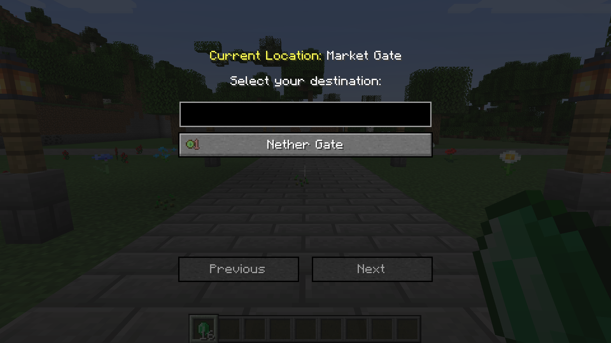
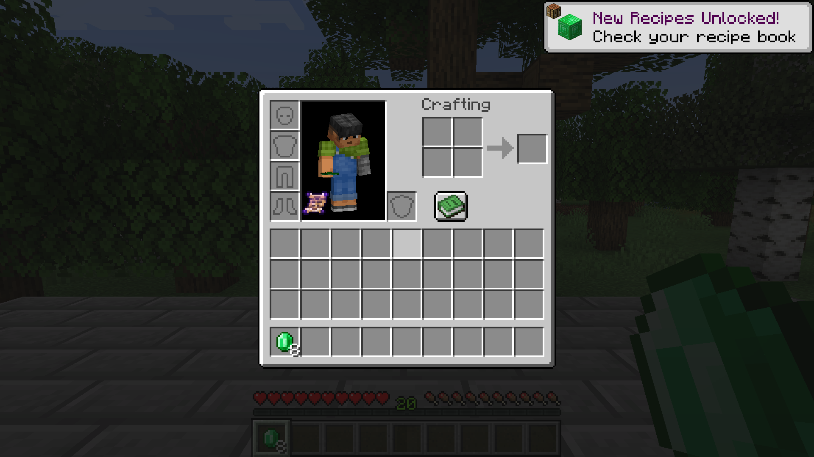

# Paid Waystones

<!-- PROJECT_PAGE_START -->

Paid Waystones lets Waystones' native emerald item costs be paid with vanilla emeralds or emerald blocks.

Waystones remains the sole owner of pricing. Configure costs with `teleports.warpRequirements` in `config/waystones-common.toml`.

When a native item cost charges `minecraft:emerald`:

- One emerald block counts as nine emeralds.
- Excess value is returned as loose emeralds.
- Creative-mode players are not charged.
- Legacy Waystones rollback calls refund the consumed emerald value.
- Other item, experience, level, cooldown, source and dimensional requirements keep their native behavior.

Paid Waystones adds no currency account, pricing configuration, command, block or item.


## Configure emerald costs (Minecraft 1.21.1)

Installing Paid Waystones does not replace Waystones' default XP prices. On Waystones 21.1.44, configure the server's `config/waystones-common.toml` (the local instance for singleplayer).

For a minimal flat price of one emerald per teleport, replace the existing `warpRequirements` list under `[teleports]` with:

```toml
[teleports]
enableCosts = true
warpRequirements = ["add_item_cost(minecraft:emerald, 1)"]
```

Edit the existing section rather than adding a second `[teleports]` section. Back up your config first and restart the server or singleplayer instance after saving. This minimal example replaces all existing warp requirements, including cooldown and exemption rules; preserve any rules you still want. It applies a flat price rather than the distance-based pricing shown in the screenshots.

Test in Survival: one emerald block should pay the one-emerald charge and return eight emeralds, without charging XP. Creative players are exempt.

- Still paying XP: the active `warpRequirements` still contains XP rules, or you edited a client config instead of the server config.
- Paying nothing: check `enableCosts = true`, the active item-cost rule, and that the player is not in Creative mode. Disabling costs does not switch the currency to emeralds.
- Emeralds work but emerald blocks do not: check that Paid Waystones and its dependencies are installed on the server as well as the client, then report the exact configuration and logs.

The `add_item_cost` syntax is documented in [Waystones' official warp rules guide](https://mods.twelveiterations.com/minecraft/waystones/guides/warp-rules). Minecraft 26.x uses a different configuration layout; this example is specifically for 1.21.1.

## Supported versions

Version 1.0.2 follows every current official Waystones loader target that has native item-cost rules:

- Minecraft 1.20.4 and 1.20.6
- Minecraft 1.21 through 1.21.11
- Minecraft 26.1.2 and 26.2
- Fabric, Forge and NeoForge wherever Waystones publishes that loader

The exact machine-readable matrix and upstream Waystones version IDs are in [`support/profiles.json`](support/profiles.json). Minecraft 1.20.2 and older are intentionally unsupported because those Waystones releases do not provide the native item-cost system this mod extends.

## Requirements

- Waystones
- Balm
- RinLib 1.0.0
- Shogi on Minecraft 26.x

Both client and server should install the mod.

## Reporting a problem

Include the Minecraft version, loader, Paid Waystones, Waystones, Balm and RinLib versions, plus the smallest reproducible payment case.

Source and issue tracker: https://github.com/rinchan-hoshino/waystone-emeralds

## Screenshots

### Emerald-denominated travel cost



With the demonstrated Waystones configuration, the 1,205-block destination visibly costs one emerald. The player starts with one emerald block and remains at experience level 20.

### Exact emerald-block change



After paying the one-emerald cost from that block, the remaining value is returned as eight emeralds while the player's experience level stays unchanged.

<!-- PROJECT_PAGE_END -->

---

## Implementation

One payment implementation uses RinLib's denomination planner. Loader builds select one of two thin Waystones adapters:

- `ItemRequirementMixin` for the classic Waystones requirement API through Minecraft 1.21.11.
- `ItemCostMixin` for the Shogi-backed rule engine on Minecraft 26.x.

The native requirement and renderer classes remain in place, so pricing, menu rendering, synchronization and teleport orchestration stay owned by Waystones.

## Build

Build one profile:

```bash
python3 tools/build_profiles.py \
  --profile 1.21.11-neoforge \
  --rinlib-dir /path/to/rinlib/build/portable-profiles
```

Build every profile by omitting `--profile`.
