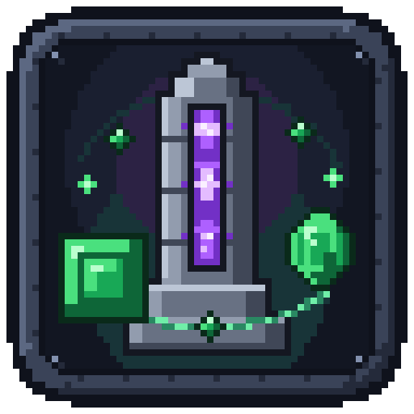

# Waystones Item Cost Extended

<p align="center"></p>

<!-- PROJECT_PAGE_START -->

**Waystones Item Cost Extended** upgrades [Waystones](https://modrinth.com/mod/waystones) teleport item costs with reversible multi-denomination payments & change, Bundle/Shulker Box deductions, combined multi-item costs, real-time cost breakdown tooltips, an in-game configuration screen, and optional [Lightman's Currency](https://modrinth.com/mod/lightmans-currency) wallet integration.

Zero external library dependencies — just install Waystones (and Balm).

---

## 30-Second Quick Start (Emerald & Combined Costs)

Waystones itself ships with XP costs by default. To charge emeralds (or multiple items at once), add `warpRequirements` to `config/waystones-common.toml` — or open this mod's in-game **Config Screen** (Mod Menu / Forge / NeoForge) and click **"Copy Emerald Cost Config Example"**:

### Minecraft 1.21.1 (Fabric & NeoForge)
```toml
warpRequirements = [
    "add_item_cost(minecraft:emerald, 3)",
    "add_item_cost(minecraft:oak_log, 2)"
]
```

### Minecraft 26.1.2 & 26.2 (Fabric & NeoForge — Shogi syntax)
```toml
warpRequirements = [
    "item_cost('minecraft:emerald', 3)",
    "item_cost('minecraft:oak_log', 2)"
]
```

### Minecraft 1.20.1 (Fabric & Forge — Waystones 14.1.x)
Because Waystones `14.1.21` does not have `warpRequirements`, enable the built-in `[legacy_1_20_1]` section in `config/waystones-item-cost-extended.toml` (or toggle it in the Config Screen):
```toml
[legacy_1_20_1]
enableCustomItemCosts = true
waiveVanillaXpCost = true
itemCosts = [
    "minecraft:emerald,1,0,0"
]
```
Format: `"item_id,base_count,per_km_extra,cross_dim_extra"`. Uses the exact same multi-denomination, nested container, and Lightman wallet payment engine.

---

## Core Features

- **Reversible Multi-Denomination Payments & Change** (`recipePayments = true` by default):
  - Automatically discovers lossless, bidirectional single-ingredient crafting chains (e.g., Iron Nugget ↔ Iron Ingot ↔ Iron Block, Emerald ↔ Emerald Block, modded storage blocks).
  - Prefers smaller denominations first to minimize change, then returns exact change greedily from largest to smallest denomination.
  - One-way or lossy recipes (such as logs → planks) are safely ignored. Server recipes are synced to clients across all versions (including Minecraft 26.x) so previews always match server datapacks.
- **Nested Container Deductions** (`searchNestedContainers = true` by default):
  - Automatically pays from **Bundles** and **Shulker Boxes** carried in your inventory.
  - Returned change is **always** placed safely into ordinary inventory/hotbar slots (`0..35`) — never into armor/offhand slots, never into containers, and never dropped on the ground.
- **Combined Item Costs**:
  - Combine multiple distinct item costs in a single teleport transaction; all costs are validated and committed atomically with rollback support.
- **Real-Time Payment Preview & Full-Inventory Diagnostics** (`showPaymentPreviewTooltip = true` by default):
  - Hovering over a Waystone cost displays the actual multi-denomination payment, change returned, wallet usage, and nested container usage.
  - Clearly distinguishes **insufficient funds** from **inventory full for change**: when you have enough value but lack space in slots `0..35` to receive change, the tooltip and rejection notice display in red how many exact slots must be freed.
- **Native In-Game Config Screen**:
  - Accessible via Mod Menu (Fabric) and the native Mods config button (Forge / NeoForge).
  - Hot-saves `config/waystones-item-cost-extended.toml` immediately, shows a live Waystones item cost detection status bar, and includes a one-click **"Copy Emerald Cost Config Example"** button.
- **Optional Lightman's Currency Integration**:
  - Supported on **1.20.1 (Forge)**, **1.21.1 (NeoForge)**, and **26.1.2 (NeoForge)** (soft-skipped on Fabric where Lightman's API differs).
  - Automatically activates when Lightman's Currency is installed. Supports all registered coin chains and equipped wallets alongside hotbar/main/offhand coins; bank accounts and loose inventory wallets are never touched.
- **4 Languages Included**: English (`en_us`), Simplified Chinese (`zh_cn`), Traditional Chinese (`zh_tw`), and Japanese (`ja_jp`).

---

## Supported Matrix (2.0.0)

| Minecraft | Loaders | Waystones Generation | Lightman's Currency |
|---|---|---|---|
| `1.20.1` | Fabric, Forge | Legacy (`14.1.21` + `[legacy_1_20_1]`) | Forge |
| `1.21.1` | Fabric, NeoForge | Requirement (`21.1.x`) | NeoForge |
| `26.1.2` | Fabric, NeoForge | Shogi (`26.1.2.x`) | NeoForge |
| `26.2` | Fabric, NeoForge | Shogi (`26.2.x`) | — |

---

## Configuration (`config/waystones-item-cost-extended.toml`)

Existing `config/waystones-item-cost-extended.properties` files from 1.x are automatically migrated on first launch (with the old file backed up to `.properties.bak`).

| Key | Default | Description |
|---|---|---|
| `recipePayments` | `true` | Allow reversible crafting denominations and greedy change. |
| `searchNestedContainers` | `true` | Deduct payment items from Bundles and Shulker Boxes in inventory. |
| `showPaymentPreviewTooltip` | `true` | Show payment/change/wallet breakdown and full-inventory warnings on Waystones tooltips. |
| `[legacy_1_20_1].enableCustomItemCosts` | `false` | *(1.20.1 only)* Enable custom item costs via Waystones teleport events. |
| `[legacy_1_20_1].waiveVanillaXpCost` | `false` | *(1.20.1 only)* Waive Waystones' vanilla XP cost when custom item costs are enabled. |
| `[legacy_1_20_1].itemCosts` | `["minecraft:emerald,1,0,0"]` | *(1.20.1 only)* List of `"item_id,base,per_km,cross_dim"` cost rules. |

<!-- PROJECT_PAGE_END -->
