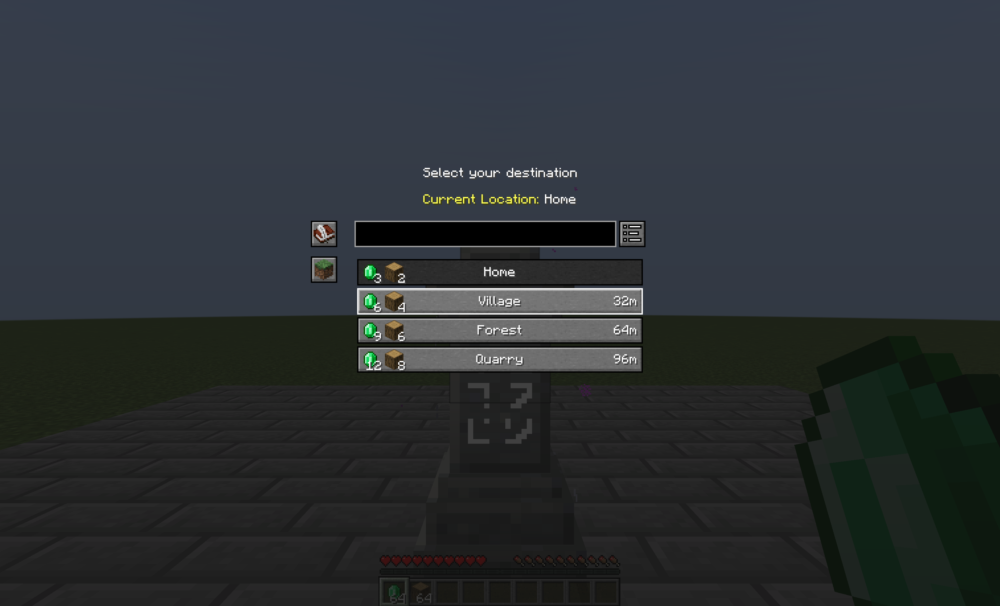
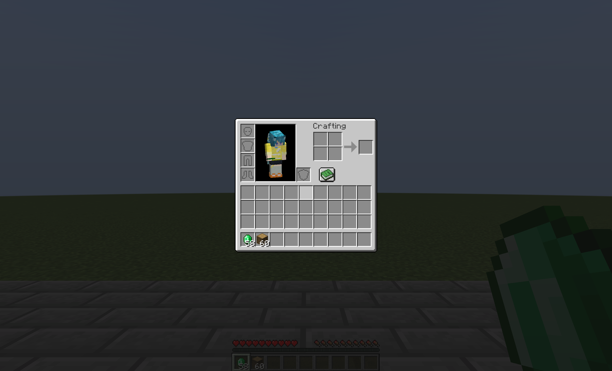
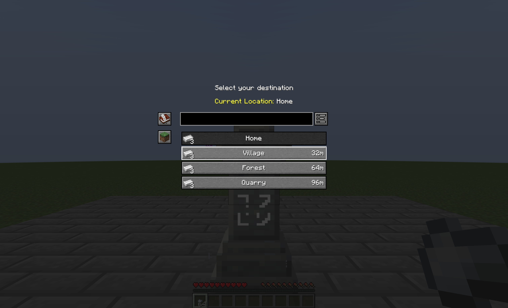
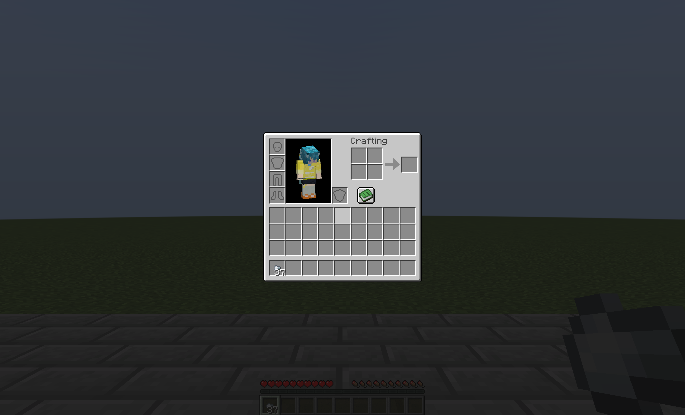
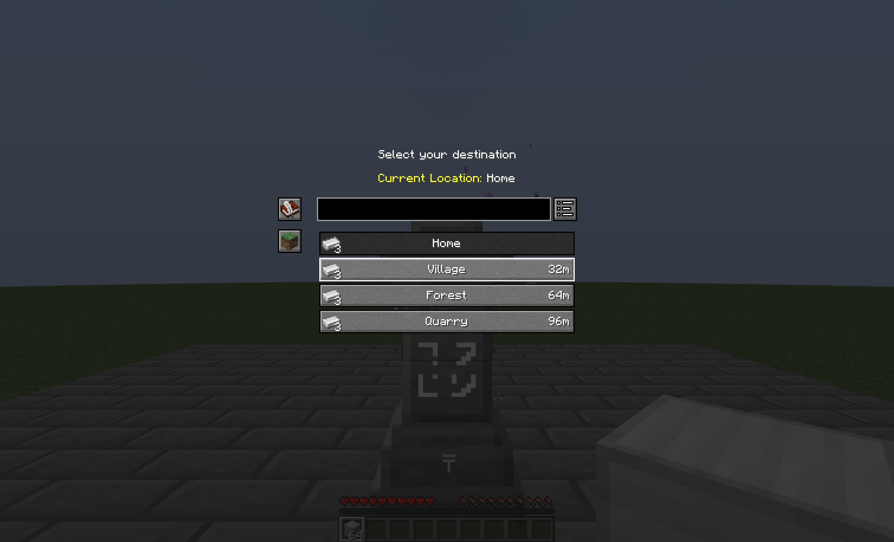
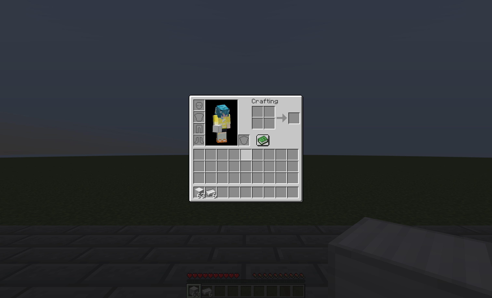

# Waystones Item Cost Extended

<p align="center"></p>

<!-- PROJECT_PAGE_START -->

Waystones Item Cost Extended is a Waystones add-on for compressed and decompressed item payments and combined item costs.

Configure item costs through `warpRequirements` in versions of Waystones that support it.

You can combine several item types in the same payment. For example, charge 3 emeralds and 2 oak logs:

```toml
warpRequirements = [
    "add_item_cost(minecraft:emerald, 3)",
    "add_item_cost(minecraft:oak_log, 2)"
]
```

On Minecraft 26.x, use Waystones’ Shogi syntax:

```toml
warpRequirements = [
    "item_cost('minecraft:emerald', 3)",
    "item_cost('minecraft:oak_log', 2)"
]
```

You can also allow items connected by reversible compression and decompression recipes to be used for payment. Set the following in `config/waystones-item-cost-extended.properties`, then restart the game or server:

```properties
recipePayments=true
```

For example, with a cost of 3 iron ingots, you can pay with 27 iron nuggets or 1 iron block and receive 6 iron ingots in change.

```toml
warpRequirements = ["add_item_cost(minecraft:iron_ingot, 3)"]
```

On Minecraft 26.x:

```toml
warpRequirements = ["item_cost('minecraft:iron_ingot', 3)"]
```

## Installation requirements

Install the following dependencies:

- [Waystones](https://modrinth.com/mod/waystones)
- [RinLib](https://modrinth.com/mod/rinlib)

## Screenshots

**Combined item costs** — destinations charge different combinations of emeralds and oak logs. Both items are deducted after teleporting.




**Decompressed item payments** — paying an iron-ingot cost with iron nuggets.




**Compressed item payments** — paying an iron-ingot cost with iron blocks.




<!-- PROJECT_PAGE_END -->
